<p align="center">
  <picture>
    <source media="(prefers-color-scheme: dark)" srcset="custom_components/bedtime_bridge/brand/dark_logo@2x.png">
    
  </picture>
</p>

<p align="center">
  <b>Shift-aware wake-up alarms for iPhone, wired into Home Assistant.</b><br>
  Reads your calendar, works out the drive, sets the alarms, and tells your house when you're up.
</p>

<p align="center">
  
  
  
  
</p>

<p align="center">
  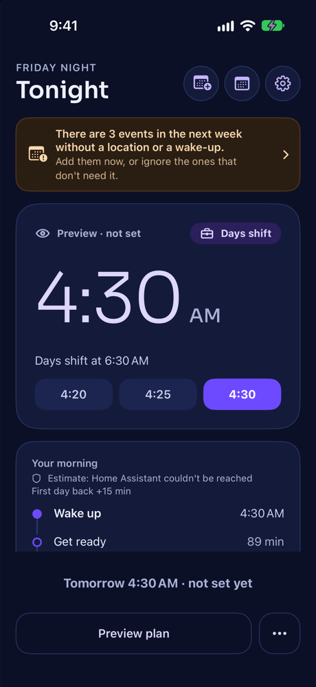
  &nbsp;
  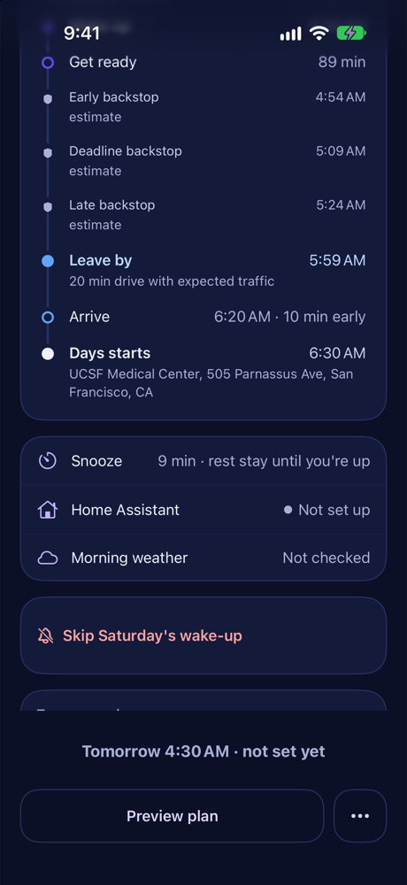
  &nbsp;
  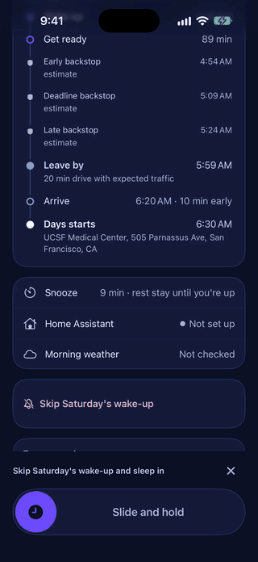
</p>

Bedtime Bridge takes over the parts of a bedtime shortcut that Shortcuts does badly: reading
the calendar, working out drive time, and setting the alarms. Your shortcut still runs the
routine and still talks to Home Assistant. It just calls this app's actions instead of a long
chain of calendar, maps and alarm actions. A companion Home Assistant integration
(`custom_components/bedtime_bridge`) turns every plan, snooze and stop into sensors, events and
helpers your automations can use.

- [A quick tour](#a-quick-tour)
- [What's in the app](#whats-in-the-app): [bottom bar](#the-bottom-bar) · [wind-down](#wind-down) · [nap](#nap) · [mornings with no alarms](#mornings-with-no-alarms) · [vacations](#vacations) · [weekly summary](#weekly-summary) · [widgets, Live Activities, controls and Siri](#widgets-live-activities-controls-and-siri) · [notifications](#notifications) · [settings](#settings-pages)
- [How it fits together](#how-it-fits-together)
- [How planning works](#how-planning-works)
- [Alarms and snooze](#alarms-and-snooze)
- [Changing tonight's plan](#changing-tonights-plan)
- [Home Assistant integration](#home-assistant-integration-recommended)
- [Phone commands](#phone-commands)
- [Away from home](#only-when-youre-home)
- [Shortcuts actions](#shortcuts-actions) · [Rewiring the bedtime shortcut](#rewiring-the-bedtime-shortcut)
- [Building](#building)

## A quick tour

All pictures are from the simulator with made-up calendar events.

<table>
  <tr>
    <td width="33%" align="center"></td>
    <td width="33%" align="center"></td>
    <td width="33%" align="center">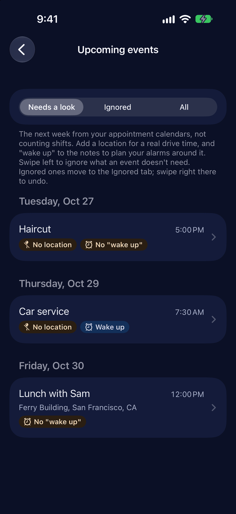</td>
  </tr>
  <tr>
    <td valign="top"><b>Tonight.</b> The next shift or appointment, the wake-up time it needs, and the whole alarm series. Preview it, then set it from the bar; bedtime sets it hands-free.</td>
    <td valign="top"><b>Your morning.</b> Wake up, get ready, the three house backstops, leave by, arrive early, start: with the drive time for that hour and any extra time for bad weather.</td>
    <td valign="top"><b>Upcoming events.</b> Next week's appointments with no location or no "wake up" note, so you can fix them before the night they matter.</td>
  </tr>
  <tr>
    <td align="center">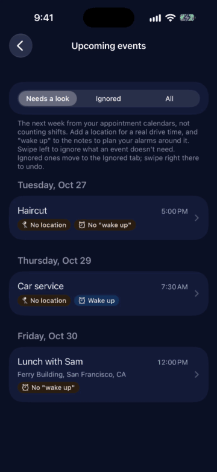</td>
    <td align="center">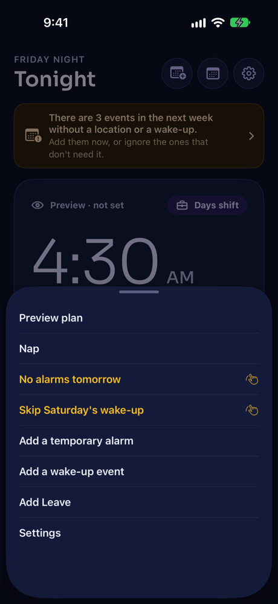</td>
    <td align="center"></td>
  </tr>
  <tr>
    <td valign="top"><b>Swipe to ignore.</b> An event that needs no wake-up or no location moves to the Ignored tab. Swipe right there to undo.</td>
    <td valign="top"><b>The bar and ⋯.</b> The bottom bar changes with the moment; ⋯ holds everything else. Amber items are protected.</td>
    <td valign="top"><b>Slide and hold.</b> Protected actions swap the bar for a slider: slide to the end and hold for 5 seconds. Letting go early does nothing.</td>
  </tr>
  <tr>
    <td align="center">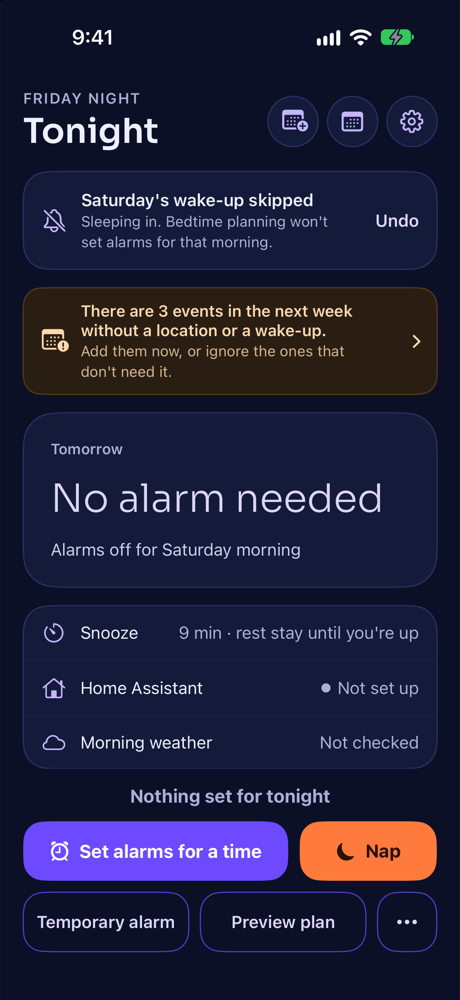</td>
    <td align="center">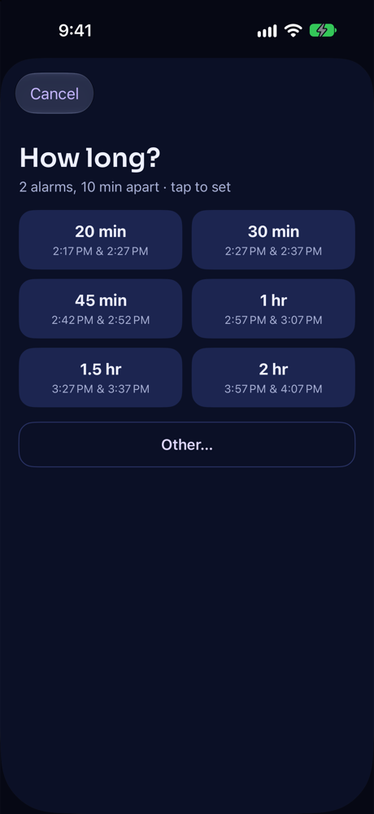</td>
    <td align="center">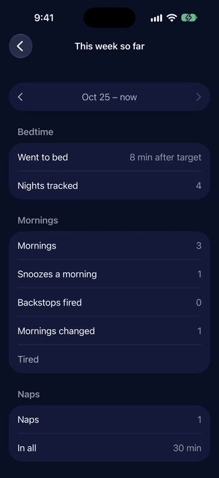</td>
  </tr>
  <tr>
    <td valign="top"><b>Skip a morning.</b> Sleep in, or wake at a different time. Skipping the night before also turns off the house's wake failsafes. Undo from the card.</td>
    <td valign="top"><b>Nap.</b> Tap a length and the alarms are set. Lengths that would run into something later today are greyed out.</td>
    <td valign="top"><b>Your week.</b> This week so far and the 8 before it: bedtime against the target, snoozes, backstops, mornings changed, naps.</td>
  </tr>
  <tr>
    <td align="center">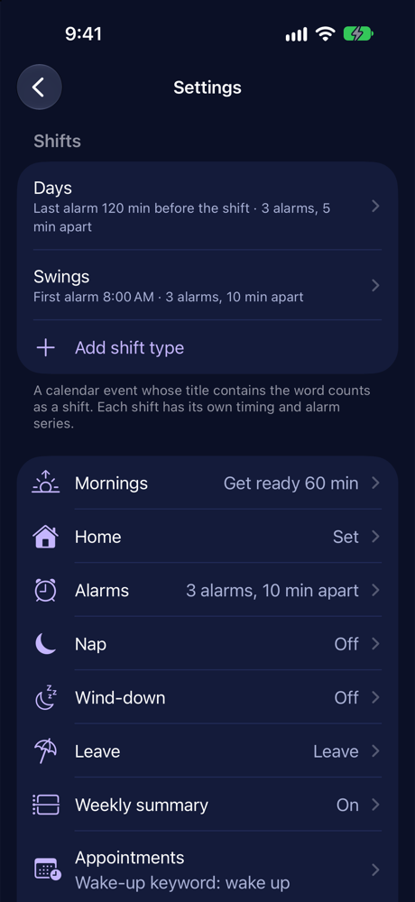</td>
    <td align="center">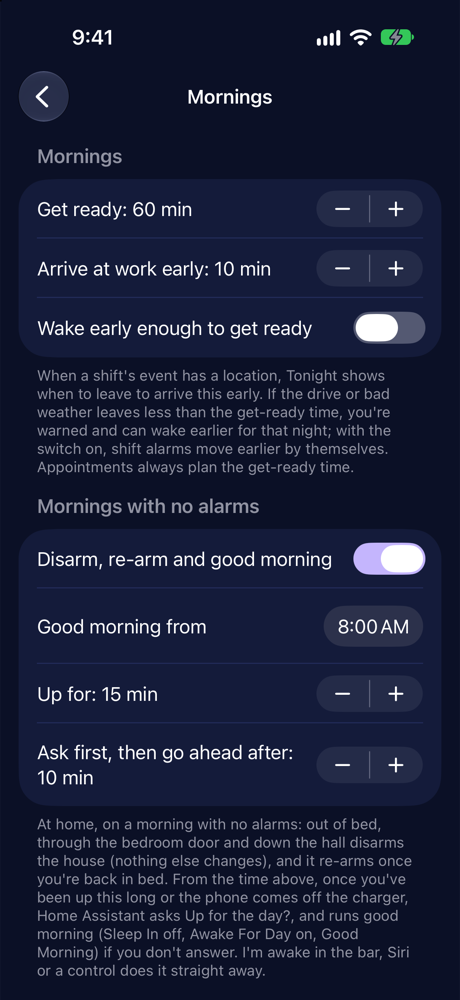</td>
    <td align="center">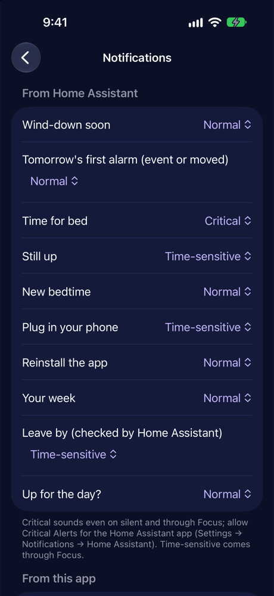</td>
  </tr>
  <tr>
    <td valign="top"><b>Settings.</b> Shifts up front, everything else in pages. Every page shows each setting's default and has its own reset.</td>
    <td valign="top"><b>Mornings.</b> Get-ready time and arriving early, and what happens on <a href="#mornings-with-no-alarms">mornings with no alarms</a>.</td>
    <td valign="top"><b>Notifications.</b> Each one Normal, Time-sensitive or Critical (Critical for the ones Home Assistant sends).</td>
  </tr>
</table>

## What's in the app

### The bottom bar

The bar at the bottom of Tonight shows what matters right now and the one or two things you'd
do next: *Plan and set alarms* in the evening, *3 alarms set* with *Sleep later* once they're
set, *I'm up early* before the first alarm, *Snoozing · rings 4:34* with *End alarms*,
*Napping · up at 2:47* with *End nap*, *Winding down · bed 9:50*, *I'm awake* on a morning
with no alarms. Everything else is in **⋯**, the same list every time with what doesn't apply
hidden.

With **alarms set and bedtime still to come**, the bar is "✓ 3 alarms set · first 9:40" (with
*Undo* while it applies), a violet **Good night** slide-and-hold that starts bedtime (Home
Assistant sends RUN_BEDTIME, the push the bedtime nudge sends), and **Change plan** and
**Temporary alarm** under it. *Change plan* holds every way to change tonight's alarms: Undo,
change times, set alarms for a time, plan from the calendar again, sleep later, and *No alarms
tomorrow* (*this morning* after midnight). Each change can be undone, one step back, until
bedtime runs. In the 2 hours before the alarms, *I'm up early* and *Sleep later* are in the bar.

With **nothing set and nothing coming** (on opening, or after a preview finds no shift or
event), the bar gets a second row: *Set alarms for a time* in violet and *Nap* in orange, then
*Temporary alarm*, *Preview plan* and ⋯.

<p align="center">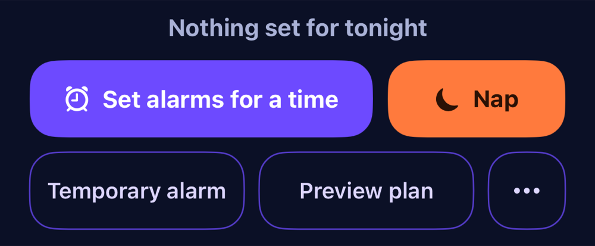</p>

It changes on time by itself while the app is open (5:00 PM, wind-down, go to bed, an alarm
passing, the morning windows closing, Undo running out), not just when you touch it.

**Protected actions** (End alarms, Not ready for bed, Back to bed, Skip, Sleep later, End nap,
No alarms tomorrow, Undo, I'm awake and others) are amber, and swap the bar for a
**slide-and-hold**: slide to the end and hold for 5 seconds while a ring fills.

<p align="center">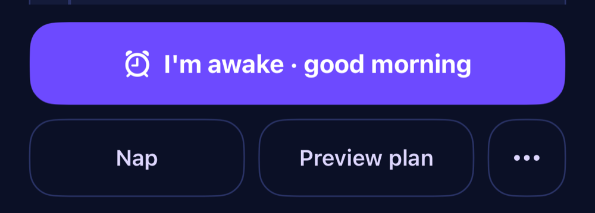</p>

### Wind-down

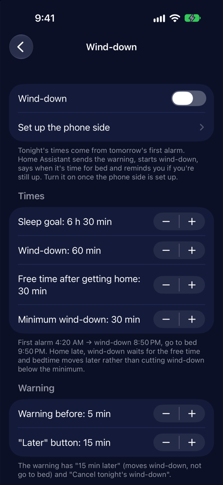

Settings → Wind-down (off until the phone side is set up). From tomorrow's first alarm and your
sleep goal, Home Assistant works out wind-down and go to bed (first alarm 4:20 → wind-down 8:50
PM, bed 9:50 PM). It warns you 5 minutes before (with *15 min later* and *Cancel*), starts
wind-down (the Winding down helper and the Wind Down On - App shortcut: Focus, Night Shift,
Reduce White Point), says when it's time for bed (critical) and reminds you if you're still up.
Getting home late moves bedtime later rather than cutting wind-down short. *Start wind-down now*
shows in the bar in the hours before. Into bed (bedroom door closed and bed occupied) ends it.

<br clear="right">

### Nap

Settings → Nap (off by default) adds a **Nap** button. Tap a length and its alarms are set
straight away (2 alarms, 10 min apart). Anything later today (a shift, an appointment with its
drive, your next alarm) greys out the lengths that would run into it, with the longest nap that
fits. At home, Home Assistant turns a napping helper on and runs your nap Focus shortcuts. Nap
alarms behave like temporary alarms: no wake routines, no Good Morning, no backstops. *End nap*
(or stopping its last alarm) clears it from the screen at once. Stop on a nap alarm's banner is
a nap stop too: the other nap alarm stays as a backup, and tomorrow's alarms are never touched.
While it's on, the widget leads with **Nap · up at 3:20** (then the morning's first alarm) and a
**Napping · up at 3:20** Live Activity counts down, with *End nap* (it opens the slide-and-hold).

### Mornings with no alarms

Sleep In on, no alarms, and you get up when you get up. At home, and only on such a morning
(Settings → Mornings → *Mornings with no alarms*):

1. **Leaving the bedroom disarms.** Out of bed, through the bedroom door, down the hall (the
   hallway presence sensors in the integration's options): Home Assistant sends `RUN_DISARM` and
   nothing else changes. Letting the dog out the patio door is safe from there.
2. **Back in bed re-arms** (`RUN_ARM_STAY`) after the same time as after a temporary alarm.
3. **Up for the day?** From 8:00 AM, once you've been up 15 minutes or the phone comes off the
   charger, Home Assistant asks, with *Good morning* and *Back to bed*. No answer and still up 10
   minutes later, it goes ahead: Sleep In off, Awake For Day on, `RUN_GOOD_MORNING` (Sleep Focus
   off, the announcement).
4. **I'm awake** does the same straight away: in the bar and ⋯, the Siri phrase *"I'm awake in
   Bedtime Bridge"*, and the **I'm awake** control (Lock Screen, Control Center, Action button).

The earliest time, the up-for and wait minutes and the whole thing on/off are in the app.

### Vacations

Settings → **Vacations** (it was Leave). An all-day event titled with one of your *Vacation
titles* (yours can stay "Leave") is a vacation: no shift alarms, the backstops off, and on
mornings with no alarms Home Assistant turns Sleep In on. There's an **Add** for each title
(in Settings, in ⋯, and from Siri, which asks which one), with an **I'm travelling** switch:
drives and the weather then come from where you are. The page lists the vacations coming up;
tap one to move it, shorten it (back early) or delete it. The evening before your first shift
afterwards, a reminder: "Back to work tomorrow: Days at 6:30 AM, first alarm 4:20 AM". Weeks with
vacation days are marked in the weekly summary, and its notification is skipped while you're
away. For a sick day, delete that day's shift.

### Weekly summary

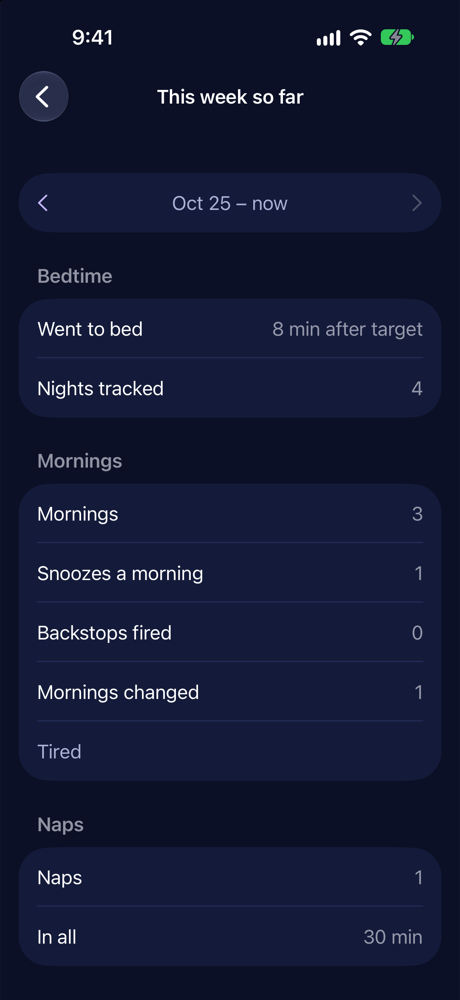

Home Assistant keeps track of each night and morning. Settings → Weekly summary → **See your
week** shows this week so far, and the arrows go back through the 8 weeks before it: when you
went to bed against the target, nights tracked, mornings, snoozes a morning, backstops fired,
mornings changed (with the reasons) and naps. Weeks start on the day and at the time set there
(Sunday 6:00 PM by default), when a notification and a Home Assistant sensor sum up the week
that just ended.

<br clear="right">

### Widgets, Live Activities, controls and Siri

- **Next Alarm widget** in every size: the Lock Screen (rectangular, circular, inline), small
  (next alarm, or "Bed in…" during wind-down), medium (the next alarm and the next four things:
  wind-down, go to bed, alarms, leave-by), and large and extra large (the night and morning as a
  timeline).
- **Live Activities:** "Bed in 42 min · first alarm 4:20" during wind-down, "Napping · up at
  3:20" during a nap, and "Leave in 25 min · 5:45" after the first stop (drive, worst case,
  weather, next backstop). With an Apple push key
  in the integration's options, Home Assistant starts, updates and ends them by push, without
  the app running (`docs/ha-handoffs-v0.4.4.md`).
- **Controls** for the Lock Screen, Control Center and the Action button: Nap, Wind-down (start or
  cancel), Tonight, I'm awake and, for the testing phase, Report something.
- **Quick actions** on the app icon (long-press), chosen in Settings → Shortcuts, controls and
  Siri.
- **Siri:** plan, cancel, nap, no alarms tomorrow, sleep later, start or cancel wind-down, good
  night (it asks first), add a vacation, add a wake-up event, I'm awake. Settings → Shortcuts,
  controls and Siri → **Siri phrases** lists each phrase, and how to make your own (a shortcut
  named what you want to say, e.g. "Let's go sleepy bye", running the Good Night action).

### Testing reports

While testing, **Report something** heads ⋯ (and is a control): type or dictate what went wrong
and it goes to Home Assistant with the app's state, what it did in the last 12 hours and a
picture of the screen. The app and Home Assistant also file reports by themselves when they see
something off (your own alarms cleared, a re-plan prompt before the alarms, in bed with no
bedtime, a push that never ran, the bedtime check failing). Settings → About → **Testing
checklist** lists what hasn't been seen working yet; some items tick themselves. Reports are in
`bedtime_bridge_reports/` in Home Assistant's config folder (`docs/ha-handoffs-v0.4.8.md`).

### Settings pages

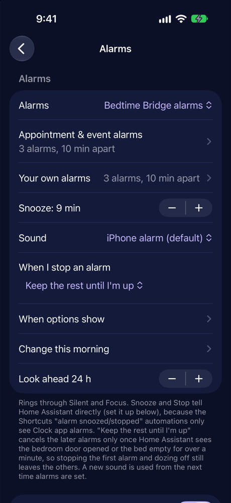

- **Alarms** opens with where alarms come from, then **Appointment & event alarms** (how many,
  how far apart, whether the wake-up time is the first or last; shifts can use these too) and
  **Your own alarms** (the series for a time you pick, including the *Set Wake-Up Alarms*
  action), then snooze, sound and the rest.
- **Clock:** Phone setting, 12-hour or 24-hour, for the app, the widgets, the Live Activities and
  Home Assistant's notifications.
- **Morning weather** on Tonight shows the forecast itself ("Rain, 52° at 5:50 · +15 min…", or
  "Clear, 38° at 8:00 AM · no extra time"): at leave time with a commute, at wake-up with alarms
  but no event, at *Good morning from* with no alarms.

<br clear="right">

### Notifications

Settings → Notifications sets each one to Normal, Time-sensitive (comes through Focus) or Critical
(sounds on silent; only for the ones Home Assistant sends, with Critical Alerts allowed for the
Home Assistant app). Defaults: *Time for bed* critical; *Still up*, *Plug in your phone*, the
leave-by reminders and *Tomorrow changed* time-sensitive; the rest normal. When Home Assistant
does the leave checks, the phone keeps one **backup reminder at leave time** ("Leave by 5:48 · not
re-checked") in case Home Assistant is down; its check withdraws the backup with a silent push.
Critical for the app's own notifications waits on Apple (`docs/critical-alerts-request.md`).

## How it fits together

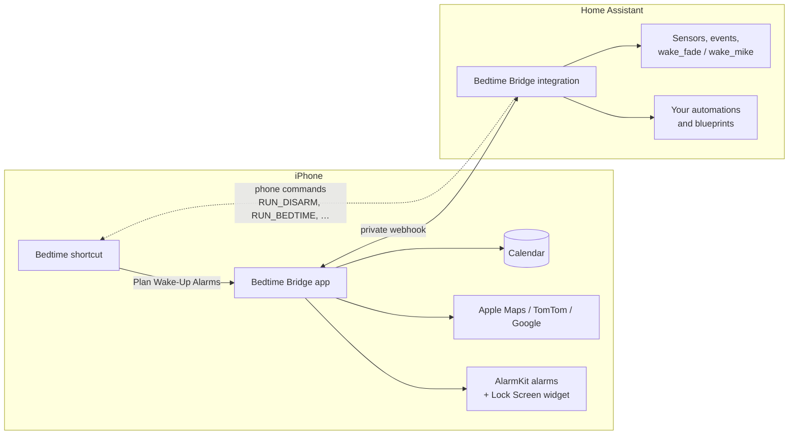

1. At bedtime your shortcut asks the app to **plan**. The app finds the next shift or "wake up"
   appointment, gets the drive time for arriving early, checks the forecast and your shift
   override, and sets the alarms.
2. The plan goes to Home Assistant, which keeps it as sensors (next alarm, leave-by, failsafe
   times) and fires a `bedtime_bridge` event.
3. In the morning, **snooze** and **stop** go straight to Home Assistant, which turns on your
   wake helpers. Stop keeps the later alarms until HA sees you're actually up.
4. When the house needs the phone (disarm the alarm system, run Good Morning or bedtime
   again), the integration sends a **phone command** that a Shortcuts automation picks up.

## How planning works

1. **Next shift.** Finds the first event within the look-ahead window (24 h by default) whose
   title contains one of your shift words (`Days`, `Swings`, …). Each shift type has its own
   settings (Settings → Shifts → tap one):
   - **Timing:** *before the shift* (e.g. Days: up 80 min before 6:30) or a *fixed time* on the
     shift's day (Swings: 8:00 AM, however late you got to bed after the last one).
   - **Alarm series:** its own number of alarms, spacing, and whether the set time is the first
     or last alarm. Or "use my usual series" (the general settings, which appointments and
     day-off alarms always use).

   Defaults: **Days** = up 120 min before the shift, last of 3 alarms 5 min apart (6:30 shift →
   4:20, 4:25, 4:30). **Swings** = first alarm at 8:00 AM, then 8:10 and 8:20. Your
   out-of-bed deadline (5:10 for Days) stays in Home Assistant, in `current_shift.yaml` and
   Wake Deadline Backstop. Fixed-time alarms don't move for
   bad weather, since the drive is hours later. If the shift override switches the shift type,
   the other shift's timing and series are used.
2. **Appointments.** Finds events whose notes contain `wake up` and that have a location. It
   gets the driving time **for arriving 10 minutes before the start**, using the traffic
   expected at that hour (see [Drive time](#drive-time)).
   Wake time = start − 10 min buffer − drive − get-ready time.
3. **Picks the earlier one.** The appointment only wins if its wake time is earlier than the
   shift's.
4. **Checks Home Assistant** (optional). It applies `input_select.select_shift_override`
   (Off = no work alarm, Days/Swings = use that shift's lead time). It warns if
   `sensor.current_shift` disagrees with the calendar, and adds extra time when the hourly
   forecast looks bad between waking and arriving.
5. **Sets the alarms.** 3 alarms 10 minutes apart (you can change this). The worked-out
   wake-up time is the **last** alarm by default, so the others go off earlier (up at 5:30 →
   5:10, 5:20, 5:30). Settings → Alarms → *Wake-up time is the* can make it the first alarm
   instead (5:30, 5:40, 5:50). The day-off *Set Wake-Up Alarms* action follows the same
   setting. Alarms are set either as the app's own
   alarms or as times for your shortcut to make Clock alarms with (see [Alarms and snooze](#alarms-and-snooze)).
6. **Nothing found.** It returns `Has Alarm = false` so your shortcut can ask about a
   day-off alarm and the Sleep In helper, as it does now.
7. **Keeps HA updated.** `sensor.bedtime_bridge_next_alarm` holds the next alarm time and cause.
   It's updated on plan, snooze, stop and cancel.

## Alarms and snooze

Settings → Alarms chooses one of two styles:

| | **Bedtime Bridge alarms** (default) | **Clock app (via shortcut)** |
|---|---|---|
| Who makes the alarms | The app (AlarmKit). Rings through Silent and Focus. | Your shortcut, with *Create Alarm* for each item in `Wake Plan › Alarm Dates`. |
| Snooze | Snooze button. **Length is adjustable** (default 9 min). The countdown shows on the Lock Screen and in the Dynamic Island. While snoozing, stopping takes a **slide**, like the Clock app, so a stray tap can't end it. The Stop screen says which alarm it is ("4:25 AM · alarm 2 of 3") and what's next. **Hold at the end of the slide for 5 seconds** (a ring fills, the phone ticks) to end every alarm left in this wake-up; letting go early stops just this one. From 2 hours before the first alarm (a setting), Tonight can end the rest of this morning's alarms the same way, even before they ring. **Plans changed?** on the snooze screen, or **Back to bed** on Tonight after you're up, moves this morning's alarms later or turns them off (a slide-and-hold, a reason, a confirm screen, a second hold and Face ID); the backstops move with it and the house goes back to bedtime. | Apple's fixed 9 minutes. |
| Morning routines | **Snooze** turns on `input_boolean.wake_fade` (Wake Snooze Fade). **Stop** turns on `input_boolean.wake_mike` (Wake Sequence). The app tells HA directly and retries if HA doesn't answer. | Your existing "Alarm is snoozed / stopped" Shortcuts automations, unchanged. |
| Sound | **iPhone alarm** (default), or one of six sounds that ship with the app: Sunrise (builds slowly), Chimes, Marimba, Harp, Classic beeps, Pulse. Settings → Alarms, with a play button to hear each. | Whatever you pick in the Clock app. |
| After Stop | **Stop never ends an alarm by itself** (0.4.10, see below): it snoozes and opens the Stop screen, where the slide ends that alarm and the hold ends them all. Rechecks traffic for the leave-by reminder. | Whatever your shortcut does. |

**Only the Stop screen ends an alarm (0.4.10).** Turning off the first alarm, switching the
lights off and falling back asleep is how Wake Deadline Backstop came to exist, so:
- **Snooze** silences the alarm and snoozes.
- **Stop** (the banner or the Lock Screen) silences it but doesn't end it. It's held as a
  snooze, or folds into the next alarm if that rings sooner (so no extra alarm appears beside
  it), and the app opens the Stop screen. Do nothing and it rings again.
- **The Stop screen** names the alarm by the time it was set for ("The 8:00 alarm · alarm 1 of 3
  · 2nd snooze") and lists what's still set ("8:10 → rings 8:19 · 8:20"). *Slide to end this
  alarm* ends that one; the others stay. *Hold at the end* for 5 seconds ends every alarm left
  in this wake-up.
- Home Assistant saying you're up (bed empty, door opened) never ends alarms; the old *When I stop
  an alarm* setting is gone. Home Assistant runs good morning on the first alarm stopped, and
  sends it again on a later stop only if the shortcut never reported it ran.

Why two styles: the Shortcuts "Alarm is snoozed / stopped" triggers only fire for **Clock app**
alarms. They never see app alarms, so in app-alarm mode the app has to tell HA itself.
**Turn off those Shortcuts automations when you use app alarms,** or a Clock alarm and an app
alarm could both fire. Also delete the Clock alarms the old shortcut toggled.

## Changing tonight's plan

Plans change after bedtime. The Tonight screen (and matching Shortcuts actions) covers the
common cases without touching Home Assistant by hand.

<p align="center"></p>

**No alarms Monday** (⋯; Skip was merged into it in 0.4.10):
- **No alarms:** the alarms are cancelled and stay off (bedtime planning won't set them again),
  with a Sleep In switch. A shift on the calendar has its override set to Off, so the house's
  wake failsafes stay quiet too: treated like the event doesn't exist.
- **Wake at a different time…:** pick a time and whether it's the first or last alarm of your
  usual series. Later plans (the bedtime shortcut, a re-plan) keep it instead of clearing it.

You can undo a skip from the same card, and Home Assistant puts the shift override back.
**Stopping an alarm in the morning is different:** that keeps the failsafes, because they're
there for the times you turn the alarm off and fall back asleep.

**Temporary alarms.** Extra alarms beside the regular ones, for getting up early and going
back to bed. Add one from the bar or ⋯; while any are set they have their own card under the top
card, where each one's time and house alarm can be changed, or it can be cancelled, and they show
on Your morning. Choose what happens to the house alarm:
- **Disarm, then re-arm:** stopping it sends `RUN_DISARM`. Once the bed sensor has seen you
  back in bed for 5 minutes (adjustable), Home Assistant sends `RUN_ARM_STAY`. If you don't
  get back into bed before the regular alarms (or within 6 hours), it doesn't re-arm.
- **Keep armed:** for a phone call or anything else you do from bed.

Either way Awake For Day, Sleep In and the regular alarms stay as they are. Temporary alarms
snooze and stop like the others, but don't turn on the wake helpers.

**Not going to sleep yet.** Got into bed early, bedtime ran, and now you want to get up for a
while? *Not going to sleep yet* turns off the regular alarms (temporary ones stay), and Home
Assistant disarms the house, turns Awake For Day back on and Sleep In off. Once you've been
back in bed for 15 minutes (adjustable), it sends `RUN_BEDTIME` and the whole bedtime routine
runs again. Both waits ignore the bed sensor's short dropouts; only an empty bed for a
minute or more starts them over.

**Day off.** No shift and no appointment? *Set a day-off alarm* picks a time (six hours from now
by default) and sets your usual series around it.

**Get-ready warning.** If the drive or bad weather leaves less than your get-ready time before
a shift, Tonight warns you and offers a one-tap earlier wake-up for that night. Turn on
*Wake early enough to get ready* and shift alarms move earlier by themselves.

**Is it set?** The Tonight card says **Preview, not set yet** until alarms are actually
scheduled, then shows what the phone really holds, read back from the system: **3 alarms set ·
4:20 4:25 4:30**, or **Couldn't set 1 of 3 alarms** in red. The Lock Screen widget shows the same
count ("3 alarms set · Leave by 6:26").

**Setting up?** `docs/setup.md` has every step for v0.4.2 – 0.4.6 in order; each version's
Home Assistant side is in `docs/ha-handoffs-v*.md`.

**More you can change after bedtime:**
- **Set alarms asks first:** a manual *Plan and set alarms* shows a preview with Set alarms and
  Cancel; **Undo** stays in the bar until bedtime runs.
- **No alarms Monday**, any time before the morning (see above).
- **Calendar changed:** "Tomorrow changed: Days shift deleted. Your 4:20 alarms are still set.
  Re-plan?" Nothing moves until you confirm.
- **Change this morning** (reason first, then just the alarms or the whole wake-up for a snow
  delay; the confirm screen shows the backstops before and after), **Sleep later** with *Back to
  planned*, and **Edit alarms** to move, add or remove any single one (from bedtime on, *Edit
  single alarms* is inside Change this morning, and ⋯ shows only that).
- **The bar (0.4.10):** the status on top, then the moment's slider the whole width (*I'm up
  early*, *Back to bed*, *Not ready for bed*; snoozing, the slide ends this alarm and the hold all
  of them), then two buttons and ⋯.
- **Your morning** shows for every alarm: each alarm, temporary ones too, the backstops, or why
  there are none ("No backstops Sunday · armed for Monday 6:30"). Once set, the top card has the
  **weather at wake-up** as a pill ("41° · Rain").
- **Wake at a different time** (day off, skip) shows a preview where you can add alarms and edit
  the backstops.
- **Add a wake-up event** (the round button at the top) and **Add <vacation>**, straight into your
  calendar.
- **Plug in your phone** at bedtime when the battery is low and it isn't charging.

## Home Assistant integration (recommended)

`custom_components/bedtime_bridge` is a companion integration. With it, the app pairs through
a private webhook instead of an admin token, and everything shows up in Home Assistant as a
**Bedtime Bridge** device.

**Install:** HACS → ⋮ → Custom repositories → add this repo as an *Integration* → install
**Bedtime Bridge** → restart HA. Then go to Settings → Devices & services → Add integration →
Bedtime Bridge. Or copy `custom_components/bedtime_bridge` into your config folder.

**Setup:** adding the integration asks only who you are, home only, the notify service, phone
commands, what snooze and stop do, and your shift types; everything else starts from its default.
Afterwards **Configure** is a menu of pages (You and home, Wake-up, Bedroom and bed, Bedtime and
wind-down, Shifts and calendar, Phone, Backstops, Keys), each saving its own options:

| Option | Default |
|---|---|
| When you snooze or stop an alarm | **Turn on helpers and fire events** (both), helpers only, or events only |
| Turn on when snoozed / stopped | `input_boolean.wake_fade` / `input_boolean.wake_mike` (any input_boolean, script, automation, switch or scene) |
| Shift override, shift sensor, weather | `input_select.select_shift_override`, `sensor.current_shift`, `weather.forecast_home` |
| Shift types | `Days, Swings` |
| You / Only run routines when you're home / Turn on to start the bedtime routine | your person entity / on / `input_boolean.bedtime_routine` |
| Bed sensor, Left-the-bedroom helper | your bed occupancy sensor, `input_boolean.bedroom_exited_today` |
| Safety-net times for / margin | `calendar` / 15 min |
| Notify action for your phone, Tell me when my plan goes out of date | e.g. `notify.mobile_app_…` / on |
| Send phone commands | off. Turn on for [phone commands](#phone-commands) |
| Sleep In helper, Awake For Day helper | `input_boolean.sleep_in`, `input_boolean.awake_for_day` |
| Curtains open after sunrise | 15 min |
| Re-arm after back in bed for / Bedtime again after back in bed for | 5 min / 15 min |
| Check these when I'm away | garage door, entry doors and front lock, when they exist |
| Napping helper, Winding down helper, Bedroom door sensor | `input_boolean.napping`, `input_boolean.winding_down`, your bedroom door |
| Hallway presence | the presence sensors just outside the bedroom ([mornings with no alarms](#mornings-with-no-alarms)) |
| Phone battery level / state | the Companion app's battery sensors (Plug in your phone, and off the charger) |
| Apple push key (.p8) and Key ID | for Live Activities by push |
| Drive times from | Phone (default), Apple Maps, TomTom, Google or Longest, with their keys |

The last step shows two addresses and a **pairing link**:
- **Anywhere:** with Home Assistant Cloud (Nabu Casa), a `https://hooks.nabu.casa/…` cloudhook,
  like the Companion app uses. It works on cellular and doesn't need remote UI turned on.
  Without Nabu Casa, your external URL if one is set.
- **At home only:** your local address, used as a fallback if your internet is down at home.

Open that step in the Home Assistant app on your iPhone and tap **Pair Bedtime Bridge**: the app
saves both. If the link doesn't open, copy it (or the addresses) into Settings → Home Assistant.
Then tap **Test connection**. The app tries the anywhere address first and falls back to the home
one. You can see all of this again under the integration's **Configure**. Keep the addresses
private. Deleting the integration also deletes its Nabu Casa cloudhook.

**Entities** (all keep their values through HA restarts):

| Entity | |
|---|---|
| `sensor.bedtime_bridge_next_alarm` | Next alarm (timestamp). Attributes: all alarm times, cause, label, style |
| `sensor.bedtime_bridge_wake_up_time` | When you need to be up (the last alarm by default, or the first) |
| `sensor.bedtime_bridge_alarm_cause` | `Days` / `Swings` / `calendar` / `automade` / `noalarm` |
| `sensor.bedtime_bridge_reason` | "Dentist at 7:00 AM. Leave by 6:26 AM (…)". Attribute: warnings |
| `sensor.bedtime_bridge_leave_by`, `_drive_time`, `_bad_weather_extra_time` | Appointment and weather details |
| `sensor.bedtime_bridge_snoozes_last_morning` | The last finished morning's snooze total (kept for statistics). |
| `sensor.bedtime_bridge_snooze_count`, `_last_event` | This morning's snoozes (back to 0 once the wake-up is over). Last event: after a plan, `alarms_set` (the app's alarms are scheduled), `planned_for_clock` (your shortcut makes Clock alarms) or `no_alarm`; otherwise the latest event (snoozed, stopped, cancelled, leave_by, …). *Preview plan* sends nothing. |
| `binary_sensor.bedtime_bridge_snoozing` | On from a snooze until the alarm rings again |
| `binary_sensor.bedtime_bridge_plan_out_of_date` | The shift override or next shift changed after you planned. Attribute: reason |
| `sensor.bedtime_bridge_last_plan` | When the phone last planned. Attribute: error, if the last attempt failed |
| Ladder early / deadline / late (`sensor.bedtime_bridge_ladder_*`; older installs keep `_safety_net_*` ids) | The leave-by backstop ladder: 50 / 35 / 20 min before leave-by (15 min earlier on a first day back). `unavailable` when not armed. See [Safety nets](#safety-nets) |
| `sensor.bedtime_bridge_ladder_status` | `armed`, `done`, `idle_override_off`, `idle_leave`, `idle_uncovered`, `idle_no_shift` or `fault`. Attributes: reason, morning, next rung |
| `sensor.bedtime_bridge_wind_down_status`, `_wind_down`, `_go_to_bed`, `_went_to_bed`, `_bed_off_target` | Tonight's wind-down: status, times, and when you actually got into bed |
| `sensor.bedtime_bridge_weekly_summary` | The week that just ended, as text. Attributes: the numbers |
| `sensor.bedtime_bridge_app_expires` | When this install of the app stops opening |
| `number.bedtime_bridge_get_ready_time`, `_arrive_early`, `_snooze_length`, `_bad_weather_extra_time_setting`, `_leave_by_reminder_lead`, `_days_lead_time`, `_swings_lead_time` | **Settings you can change in HA.** They start out matching the app after its first plan. After that, HA's value wins each time the app runs. |

**Events:** `bedtime_bridge` with `type` (`planned`, `snoozed`, `stopped`, `cancelled`,
`leave_by`) plus `alarm_cause`, `alarm_time`, `alarm_times`, `label`, `leave_by` and
`snooze_count`. `planned` also carries `alarms_set` (true only when the app's alarms are scheduled). Also fired: `bedtime`, `plan_failed` (with `error`), `plan_outdated`
(with `reason`), `skipped` / `unskipped`, `temporary_snoozed` / `temporary_stopped`,
`temporary_rearmed`, `bedtime_undone`, `bedtime_rerun`, and on mornings with no alarms
`left_bedroom` (`disarmed`) and `good_morning` (`by_hand`, `disarmed`, `sent`). Test alarms add `test: true`. With *helpers only*, or while you're away,
snoozed/stopped aren't fired.

**Helpers or blueprints, your choice:**
- *Helpers:* your existing Wake Snooze Fade and Wake Sequence blueprints keep watching
  `wake_fade` / `wake_mike`. Nothing to change. They also no longer need to be in the HomeKit
  Bridge for this.
- *Events:* import `blueprints/automation/bedtime_bridge/bedtime_bridge_alarm_event.yaml`
  (Settings → Blueprints → Import, using the raw GitHub URL). Pick an event (for example
  "Alarm snoozed"), optionally limit it to causes like `Days`, and add your actions.
- *Both* is the default, so you can move routines over one at a time. Don't let a helper-driven
  automation and an event-driven automation do the same thing, or it will run twice.

Settings changed in HA reach the app the next time it runs (bedtime, snooze or stop). HA can
reach the phone only through [phone commands](#phone-commands), which run shortcuts.

**Updates through HACS:** every time the `version` in
`custom_components/bedtime_bridge/manifest.json` changes on `main`, a GitHub Action
(`.github/workflows/release.yml`) publishes a release named after it (for example `v0.2.0`).
HACS offers that as an update, the same way your washer-and-dryer card does. So a change ships
by bumping the version and merging. After updating in HACS, restart Home Assistant.

**Icon and logo:** the Crescent icon and a Bedtime Bridge logo ship in
`custom_components/bedtime_bridge/brand/`, so Home Assistant 2026.3 and later show them on
the integration card instead of the "icon not available" placeholder. Older versions show the
placeholder.

The integration has its own tests (`pytest`, with `pytest-homeassistant-custom-component`).

## Phone commands

Some things only the phone can do (in my case the house alarm lives in a phone app, not in
Home Assistant). With **Send phone commands** on in the integration's options, Home Assistant
sends a notification with a marker word, and a Shortcuts **When I receive a notification**
automation (iOS 27) runs the matching shortcut:

| Marker | Sent when | Run this |
|---|---|---|
| `RUN_DISARM` | A temporary alarm (disarm mode) is stopped, *Not going to sleep yet*, or leaving the bedroom on a morning with no alarms | Your disarm shortcut |
| `RUN_ARM_STAY` | You've been back in bed long enough after a temporary alarm or a trip out on a morning with no alarms | Your arm-stay shortcut |
| `RUN_BACK_TO_BED` | *Back to bed* after you're up (moving or cancelling this morning's alarms) | Back To Bed - App: MorningState back to sleeping, arm stay, Sleep Focus on |
| `RUN_GOOD_MORNING` | The first stop of a wake-up while you're home (Wake Mike too runs once per wake-up); on a morning with no alarms, *Up for the day?* or *I'm awake* | Good Morning (curtains, house alarm, briefing) |
| `RUN_PLAN_PREVIEW` | Before wind-down, to check tomorrow | Preview Tomorrow - App |
| `RUN_WIND_DOWN` / `RUN_CANCEL_WIND_DOWN` | Wind-down starts / is cancelled | Wind Down On - App / Wind Down Off - App |
| `RUN_NAP_START` / `RUN_NAP_END` | A nap starts / ends | Nap Start - App / Nap End - App |
| `RUN_MORNING_UPDATE` | The morning Live Activity's refresh, when there's no push key | Morning Update - App |
| `RUN_BEDTIME` | Back in bed after *Not going to sleep yet* (and the existing bedtime nudge) | The bedtime shortcut |
| `RUN_LEAVE_CHECK` | Each leave reminder, while you're home (v0.4.1) | Bedtime Bridge **Check Drive and Remind** (no shortcut needed) |

Set each automation to *Run Immediately* and match on the message containing the marker.

Each command has its own notification, and Home Assistant takes it off the phone once it
knows the shortcut ran. For bedtime that's automatic (the shortcut's **Start Bedtime Routine**
step tells it). For the others, add **Report Shortcut Ran** as the last step of each shortcut
(Disarm, Arm Stay, Good Morning), with the matching command. Its **Outcome** is *Started*
(the default; put it first), *Completed* (put it last) or *Already done* (where a shortcut stops
early because there's nothing to do, like Good Morning when it already ran that night). The
`command_ran` event and Last event's `last_command` attribute show which. Once a shortcut has
reported *Completed*, a later run that starts but doesn't complete within 5 minutes (an option)
fires a `command_incomplete` event and notifies you.
The integration also keeps **Sleep In** in sync with the plan (while you're home): on when the
first alarm is after the curtains would open (sunrise + **Curtains open after sunrise**,
default 15 min), off when it's before. Skipping a morning with *Sleep in* turns it on.

## Only when you're home

Wake-up and bedtime routines only run in Home Assistant while you're home, so a hotel night
doesn't light up an empty house.

- **Wake side:** when you snooze or stop, the integration checks your person entity. If you're
  away, it doesn't turn on `wake_fade` / `wake_mike` and doesn't fire the snoozed/stopped
  events. The state still updates, and `sensor.bedtime_bridge_last_event` shows
  `skipped_away: true`.
- **Bedtime side:** replace the shortcut's HomeKit "turn on Bedtime Routine" step with the app's
  **Start Bedtime Routine** action. It asks the integration, which turns on
  `input_boolean.bedtime_routine` only if you're home, and returns *Started* (true/false) so the
  shortcut can skip or change later steps.
- **Clock app mode:** in the Shortcuts "Alarm is snoozed" and "Alarm is stopped" personal
  automations, replace the HomeKit helper steps with **Report Alarm Event** (Snoozed / Stopped),
  so the same check applies.
- **Wake Plan › At Home** is false when you're away, and the Tonight screen shows "away".
- **Away bedtime.** The bedtime shortcut branches on *At Home*. Away, it skips every house step
  (no disarm, no car charging check) and speaks the **Away Bedtime Summary** instead: your
  alarms, tomorrow's weather where you are, and a check of the house (alarm still armed, the
  entities in *Check these when I'm away*). When nothing's wrong it just says "Everything at
  home is good."
- **Drives from where you are.** With *Start from where I am when away* (Settings → Drive
  time), appointment drives start from your current location instead of home.

Set it up in the integration's options: **You** (defaults to your person entity), **Only run
routines when you're home** (on), and **Turn on to start the bedtime routine**
(`input_boolean.bedtime_routine`). Unknown or unavailable presence counts as home, so a tracker
glitch never skips your morning while you're in bed. Without the integration, the same three
settings are in the app (token mode).

Anything that still flips those helpers directly (an old HomeKit step, a dashboard button)
bypasses the check. Route it through the app's actions instead.

## Safety nets

- **Test alarm.** Settings → Alarms → **Test alarm in 2 minutes** (app alarms). It rings once.
  Snooze it, then stop it, and your real routines run (if you're home). HA marks those events
  `test: true` and leaves tonight's plan alone.
- **If planning fails.** If the calendar can't be read, *Plan Wake-Up Alarms* falls back to Home
  Assistant's next shift (`sensor.current_shift`) and sets your usual alarms with a warning.
  Appointments aren't checked in that case. If HA can't help either, the action fails visibly
  in the shortcut and tells HA the plan failed.
- **No plan by bedtime.** `sensor.bedtime_bridge_last_plan` records every plan (its `error`
  attribute shows a failure). The **Bedtime Bridge missing plan** blueprint checks once you've
  been in bed for 20 minutes (bed sensor, 8 PM to 5 AM). That's when your routine should have
  run, so swing nights (home at midnight, asleep at 2 AM) don't raise false alarms. If a shift
  starts within 14 h and there's no fresh plan, or the last one failed, it sends a
  time-sensitive notification with a **Plan now** button.
- **Leave-by backstop ladder.** For Days shifts and appointments with a location, the integration
  publishes three times before leave-by for Wake Deadline Backstop: **early** 50 min before
  (alarms were set and snoozing is over), **deadline** 35 min before (forgot the alarm; still
  time to get ready), **late** 20 min before (last moment). On a first day back (no shift the day
  before) all three are 15 min earlier. Leave-by is the app's (traffic- and weather-aware), or
  the calendar's (shift start − 35 min fallback drive − 10 min early) when there's no plan for
  that morning; the app's may be at most 30 min later than the calendar's. The alarms never move
  it. From the early rung until an hour after the late rung it's locked: only a deliberate
  morning change, or worse weather or traffic (earlier only), moves it. It's off only with the
  shift override `Off`, a leave day, a shift type without a ladder, or no shift on the calendar,
  and `sensor.bedtime_bridge_ladder_status` says which. The settings are number entities in
  Home Assistant. What fires at each rung stays in the Backstop blueprint.
- **Plan out of date.** If the shift override or HA's next shift changes after you planned (and
  before you wake), `binary_sensor.bedtime_bridge_plan_out_of_date` turns on and a
  `plan_outdated` event fires. If you set a notify action in the integration, you get a
  notification with **Re-plan now** (opens `bedtimebridge://replan`, and the app plans again).
  Routine refreshes with the same shift time don't count. Calendar edits on the phone itself
  can't be seen by HA; the app picks those up the next time it plans.
- **Appointments without a location.** A "wake up" appointment with no location still gets an
  alarm. Until you answer, it's planned with the fallback drive time (30 min), so an unanswered
  question errs toward waking early. You get a quiet notification, *"Dentist has no location.
  Should it have a location?"*, that you can answer from the Lock Screen:
  - **Add location:** type the place right in the notification. It's saved to the calendar
    event and the app re-plans in the background with the real drive time.
  - **No location needed:** remembered for that event. The app re-plans with no drive.
  - **Ignore it:** the safe plan stands. The Tonight screen shows the same question as a card.

  The shortcut never waits on this (see below).

## Hands-free bedtime

The bedtime flow runs with nobody tapping: the bed sensor → HA's notification → the shortcut.
So **Plan Wake-Up Alarms**, **Start Bedtime Routine** and **Set Wake-Up Alarms** never ask
questions or wait for input. Anything that needs you (a missing location, an out-of-date
plan, a missing plan) comes as a notification you can answer later or ignore, with a safe
default. The shortcut's own day-off questions are unchanged: no answer still means no alarm
and Sleep In.

## Lock Screen widget

Add **Next Alarm** from the widget gallery (Bedtime Bridge); every size is there (see
[widgets](#widgets-live-activities-controls-and-siri)). It shows the next alarm time, why it's
set ("Days shift", "Dentist", "Day off"), and leave-by on shift and appointment mornings. While
snoozing it shows the snooze time instead. After the last alarm it keeps showing "Leave by" and
the event until 30 minutes past it (Settings → Drive time).

The app updates it whenever alarms change (plan, snooze, stop, cancel). It moves on to the next
alarm by itself as each one passes. In Clock app mode it shows the planned times but can't
see Clock snoozes. The app and widget share data through the App Group
`group.<bundle ID>`, which follows `APP_BUNDLE_ID` automatically.

## Leave-by reminder and bad weather

- **Leave reminders.** On shift and appointment mornings you get a reminder at each time you pick
  in Settings → Leave-by reminder → Leave reminders (any of at leave time, 5 to 30 min before;
  default 15 min before and at leave time). Each one re-checks the drive with current traffic:
  Home Assistant sends `RUN_LEAVE_CHECK`, and **Check Drive and Remind** notifies ("Leave by 5:48 ·
  32 min drive (5 min worse than planned)", "Leave now · 35 min drive"). Later reminders, the
  widget and the backstops (earlier only) follow the new leave-by. The app also re-checks when you
  stop an alarm and when you open it that morning. Without Home Assistant the bedtime reminders
  still arrive, 2 min after each time, marked "not re-checked". They stop once you've left, 15 min
  after leave-by, or when the morning is changed or skipped.
- **Bad weather.** Uses an hourly forecast, from Home Assistant (`weather.forecast_home`), the
  free **Open-Meteo** service, or **Apple Weather** (Settings → Bad weather → *Forecast from*). Each condition can
  use the default extra time, its own amount (snow: 30 min), or be off. It reads the forecast
  from your first alarm until you need to be there. If a condition that's on shows up (by
  default snow, sleet, hail, heavy rain and thunderstorms, or rain at freezing), it adds that
  condition's time (default 15 min; the longest wins). Shift alarms go off
  earlier. Appointment drives get the time added, so leave-by moves too. The Wake Plan reason
  says why ("+15 min for pouring at 6 AM").

## Look: Nightfall

The app uses a dark-only theme called **Nightfall**: midnight blue backgrounds (`#0B1026`, with
cards in `#141B3A`), violet buttons (`#6D4AFF`) and violet text (`#DDD6FE`). Accent colors:
mint for connected, sky blue for leave-by, amber for weather warnings. Colors live in
`Shared/Theme.swift`, so the widgets and the snooze Live Activity match. Times and titles use
**Sora** (light for the big alarm time); body text is SF Pro. The five Sora weights in
`Shared/Fonts` are static cuts of Google Fonts' variable Sora, made with fontTools. They're
used under the SIL Open Font License (`Shared/Fonts/OFL.txt`, shipped inside the app).

## App icon

Three Nightfall icons: **Crescent** (the default), **Bridge** and **Night dial**. Pick one under
Settings → App icon. Sources are in `design/icons/*.svg`. The 1024 px PNGs in
`BedtimeBridge/Assets.xcassets` (`AppIcon`, `AppIcon-Bridge`, `AppIcon-Dial`) were rendered from
them; re-render after editing a design.

## Shortcuts actions

| Action | Use |
|---|---|
| **Plan Wake-Up Alarms** | The main step. Returns a *Wake Plan*: `Has Alarm`, `Wake-Up Time`, `First Alarm`, `Alarm Times`, `Alarm Dates`, `Needs Clock Alarms`, `Alarm Cause`, `Reason`, `Warnings`, `Home Assistant JSON`. Turn off *Set Alarms* to preview only. If nothing needs an alarm, it also clears the app's old alarms. |
| **Set Wake-Up Alarms** | The day-off path. Give it your wake-up time and it sets *Your own alarms* from it (starting at it by default). A time already past today rolls to tomorrow. |
| **Cancel Wake-Up Alarms** | Clears every alarm the app has set and the leave-by reminder. |
| **Set Temporary Alarm** | One extra alarm at a time, with *House Alarm*: disarm then re-arm, or keep armed. See [temporary alarms](#changing-tonights-plan). |
| **Undo Bedtime** | *Not going to sleep yet*: regular alarms off, house disarmed, Awake For Day on, Sleep In off; bedtime runs again once you're back in bed. |
| **Away Bedtime Summary** | Text to speak at bedtime away from home: alarms, weather, house check. Changes nothing. |
| **Start Bedtime Routine** | Turns on the bedtime helper through the integration, only if you're home. Returns *Started*. |
| **Report Alarm Event** | For Clock app mode: reports a snooze or stop so the home check applies. |
| **Report Shortcut Ran** | Last step of a shortcut a [phone command](#phone-commands) runs, so Home Assistant clears that command's notification. |
| **Check Drive and Remind** | Run by the `RUN_LEAVE_CHECK` automation: re-checks this morning's drive, notifies when to leave, tells Home Assistant the new leave-by. |
| **Get Drive Time** | Drive minutes from home to a place, arriving by a given time. Useful in other shortcuts. |
| **Nap**, **No Alarms Tomorrow**, **Sleep Later**, **Start / Cancel Wind-Down**, **Add Vacation**, **Add a Wake-Up Event**, **I'm Awake** | The same as in the app, for Siri and your own shortcuts. |
| **Preview Tomorrow**, **Morning Update** | Run by the `RUN_PLAN_PREVIEW` and `RUN_MORNING_UPDATE` automations. |

## Alarm cause

Every Wake Plan carries an **Alarm Cause** (`alarm_cause` in the JSON) telling Home Assistant why
the alarm exists:

| Value | Meaning |
|---|---|
| `Days`, `Swings` | Work shift. The value is the shift word from Settings, so spell it the way HA expects (these match `input_select.select_shift_override`). |
| `calendar` | A calendar appointment noted "wake up" |
| `automade` | You picked the time (Set Wake-Up Alarms) |
| `noalarm` | No alarm was set |

If you skip the day-off alarm, send the Wake Plan from *Plan Wake-Up Alarms*. It already says `noalarm`.

## Drive time

Pick the service in Settings → Drive time. All three plan for arriving by *start − buffer*
(10 min by default).

| Service | How arrive-by works | Needs |
|---|---|---|
| **Apple Maps** (default) | Takes an arrival time directly and uses the traffic it predicts for that hour. | Nothing. Free. |
| **TomTom** | Takes an arrival time directly (`arriveAt`) and uses its historical traffic for that time and day. One request per appointment. | API key from developer.tomtom.com (the free tier is plenty), home address |
| **Google** (Routes API) | Driving routes only take a **departure** time, so the app works backwards. It tries leaving 30 min early, sees when you'd arrive, moves the departure by the difference and repeats (at most 4 requests). It keeps the latest departure that still arrives on time. Optional *Plan for heavy traffic* uses Google's pessimistic traffic model. | Routes API key, home address |

**Longest of all** asks every service you have a key for (and Apple Maps) and plans with the
longest drive. With a Google key, its heavy-traffic worst case is always fetched and shown on
the morning timeline, whichever service you plan with.

API keys are stored in the iOS Keychain. If a service fails (no signal, bad key), the app uses
the fallback drive time from Settings. You'll see a warning in `Warnings`, and the JSON marks it
`drive_time_estimated: true`.

## Rewiring the bedtime shortcut

Replace the calendar, maps and alarm part of the shortcut with:

```
Plan Wake-Up Alarms (Set Alarms: on)            → Wake Plan
If  Wake Plan › Has Alarm  is  false
    Ask for Input (Time) "Alarm for your day off?"
    If  Provided Input has any value
        Set Wake-Up Alarms (Wake-Up Time: Provided Input)  → Wake Plan
    End If
    Choose from Menu "Turn on Sleep In?"  …                 (your existing step)
End If
Start Bedtime Routine                    → Started      (replaces the HomeKit "Bedtime Routine on" step)
If  Wake Plan › Needs Clock Alarms  is  true              (Clock app mode only)
    Repeat with Each item in Wake Plan › Alarm Dates
        Create Alarm at Repeat Item
    End Repeat
End If
…arm house alarm (existing)…
…send to Home Assistant (existing). Send Wake Plan › First Alarm and
   Wake Plan › Alarm Cause, or the whole Wake Plan › Home Assistant JSON…
```

Everything after that stays the same: Home Assistant sets `input_boolean.sleep_in` from the
alarm time and sends back the spoken readout.

`Home Assistant JSON` looks like this:

```json
{"alarm_cause":"calendar","alarm_time":"2026-10-26T05:26:00-04:00","alarm_times":["…","…","…"],
 "appointment":{"drive_minutes":24,"drive_time_estimated":false,"leave_by":"2026-10-26T06:26:00-04:00",
                "location":"…","start":"2026-10-26T07:00:00-04:00","title":"Dentist"},
 "has_alarm":true,"reason":"Dentist at 7:00 AM. Leave by 6:26 AM (24 min drive, 10 min early)",
 "shift":{"start":"…","title":"Days"}}
```

## Building

Requires Xcode 27 (free from the Mac App Store) and an iPhone on iOS 27 or later. No Homebrew or Terminal needed; the Xcode project is in the repo.

1. Get the code: on GitHub, **Code → Download ZIP** and double-click the ZIP, or in Xcode
   **Clone Git Repository…** with `https://github.com/2tk785fryr-tech/ha-ios-bridge-app`.
2. Open `BedtimeBridge.xcodeproj`.
3. Click the blue **BedtimeBridge** project at the top of the sidebar. For each of the three
   targets (BedtimeBridge, BedtimeBridgeWidgets, BedtimeBridgeTests), open *Signing &
   Capabilities* and pick your Apple ID under **Team** (Xcode → Settings → Accounts to add it).
   If Xcode says the bundle ID is taken, change `APP_BUNDLE_ID` under the project's *Build
   Settings* (the widget, tests and App Group follow it).
4. Plug in your iPhone, trust the Mac, and turn on Settings → Privacy & Security → Developer Mode.
5. Pick your iPhone at the top of Xcode and press ⌘R. The first time, allow the developer
   certificate on the phone under Settings → General → VPN & Device Management.

**Reinstalling.** An app signed with a free Apple ID stops opening 7 days after it's installed;
with a paid Developer Program membership it lasts a year. Bedtime Bridge warns you on the main
screen from 3 days before (red on the last day), and Home Assistant reminds you at bedtime on the
last 2 days (sensor *App expires*). To reinstall, plug in the iPhone, open the project in Xcode
and press ⌘R. Settings, the Home Assistant pairing and your alarms are kept.

On first launch, tap **Preview plan** to grant calendar access.
Tap **Plan and set alarms** once to grant alarm access and notifications. Then open the gear and set:

- your shift words and how long before each shift you want the first alarm
- get-ready time (default 60 min) and arrive-early buffer (default 10 min)
- drive-time service and API key, and your home address (required for TomTom and Google; with
  Apple Maps a blank address uses your current location)
- which calendars hold shifts and appointments (none ticked = all calendars)
- alarm style and snooze length
- Home Assistant URL and a long-lived access token (HA → your profile → Security), then tap
  **Test connection**. The helper names default to your existing ones (`wake_fade`,
  `wake_mike`, `select_shift_override`, `current_shift`, `forecast_home`). Plain `http://`
  works on your home network. Away from home, use your Nabu Casa or other `https` URL.

The planning logic (`WakePlanner.swift`, `PlanAdjustments.swift`, `DepartureSolver`) has no
EventKit, MapKit, AlarmKit or network code and is covered by `BedtimeBridgeTests` (⌘U).

## Layout

```
BedtimeBridge/
  App/        app entry point
  Core/       settings, WakePlanner + PlanAdjustments (pure logic), calendar, AlarmKit,
              Home Assistant client, leave-by reminder, coordinator
    DriveTime/  Apple Maps, TomTom and Google drive-time providers
  Intents/    Shortcuts actions, Snooze/Stop button actions, Wake Plan result type
  Views/      main screen and settings
BedtimeBridgeWidgets/  "Next Alarm" widget (every size), the snooze, wind-down and morning Live Activities,
                       and the Lock Screen / Control Center controls
Shared/       Nightfall theme, alarm metadata and widget snapshot used by the app and the widgets
BedtimeBridgeTests/
custom_components/bedtime_bridge/  Home Assistant integration (HACS)
  brand/      integration icon and logo (rendered from design/icons/crescent.svg)
blueprints/automation/bedtime_bridge/  "Bedtime Bridge alarm event" blueprint
tests/ha/     integration tests
docs/         setup guide, Home Assistant hand-offs per version, shortcuts, specs, README pictures
BedtimeBridge.xcodeproj  Xcode project (open this)
```
